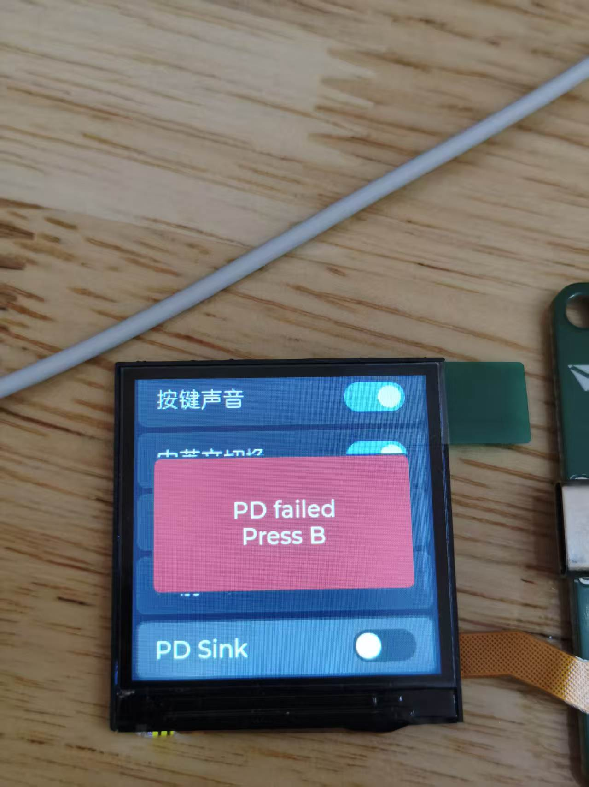
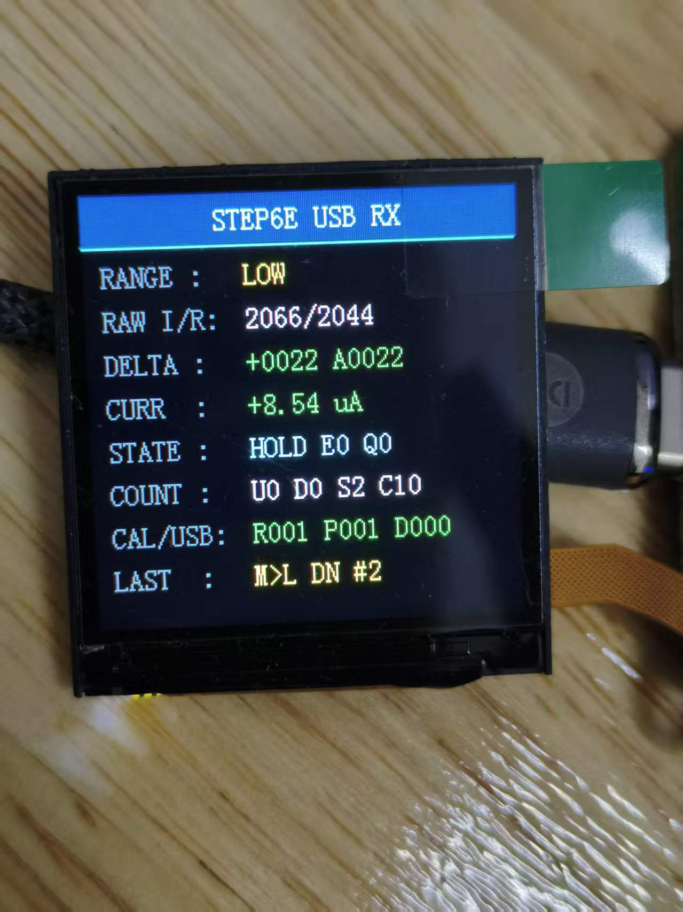
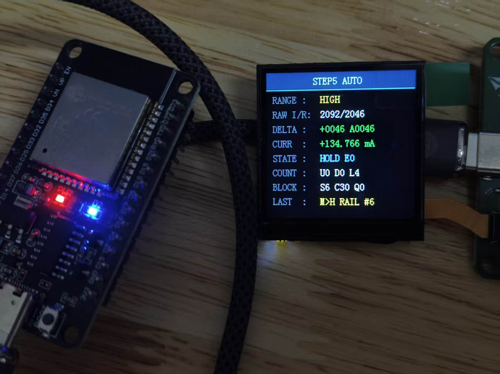

# PowerPico 调试与问题记录

本文件只保留适合公开展示、面试时能够讲清楚的问题。大量个人学习笔记和过程文档保留在本地 `DOC` 目录，不再上传到公开仓库。

## 1. PD失败页面退出后的对象生命周期

### 现象

PD 协商失败时，设置页面会显示失败提示。页面退出或重建后，如果页面私有定时器仍继续运行，就可能再次访问已经删除的 LVGL 对象。

### 原因

LVGL 页面对象有明确生命周期，定时器回调却可能晚于页面销毁执行。问题不在 PD 协议本身，而在“定时器还活着、页面对象已经没了”。

### 处理

- 页面创建时保存私有轮询定时器句柄。
- 页面退出、重建或异常返回时统一删除定时器并清空句柄。
- 回调中继续检查当前页面状态，避免跨页面更新对象。

### 面试表达

这个问题体现的是异步回调和 GUI 对象生命周期管理。修复重点不是简单加延时，而是保证创建和销毁成对，避免定时器持有失效对象。

## 2. ADC与自动量程的分阶段验证

项目早期没有直接把所有逻辑一次接到正式界面，而是先使用临时页面观察 ADC 原始值、电压电流换算和档位状态。

| ADC采集与换算调试 | 负载接入与量程切换调试 |
| --- | --- |
|  |  |

### 验证顺序

1. 先确认 TIM2、ADC 和 DMA 能持续产生稳定数据块。
2. 再核对电压、电流换算和三档量程对应关系。
3. 接入 ESP32 动态负载，观察升档、降档和切档后的数据稳定过程。
4. 自动量程稳定后，再接入正式 LCD 页面和 USB 波形链路。
5. 工程整理阶段删除临时页面、观察变量和失效调试接口，只保留生产逻辑。

### 保留下来的保护逻辑

- 连续多个数据块满足条件后才允许切档，避免单点噪声触发。
- 切档后跳过若干数据块，丢弃模拟开关尚未稳定时的旧数据。
- 设置冷却时间，避免在阈值附近来回抖档。
- MID 档贴近 ADC 电源轨时优先升档，避免输入饱和后继续使用失真数据。

## 3. USB上位机部分的公开边界

本项目使用上游既有通信格式和官方 PowerPico Client 完成 USB CDC 基础联调。当前能够说明的是：设备可枚举、可重连、基础命令可交互、实时波形可显示，连续读取校准参数 20 次正常。

由于没有上位机源码，且当前复盘重点是 STM32 App 固件，因此公开材料不展开上位机内部架构，也不把通信格式和客户端实现作为个人原创成果。面试时应把重点放在 STM32 侧的回调与任务边界、数据缓冲生命周期，以及自己实际完成并验证的部分。
