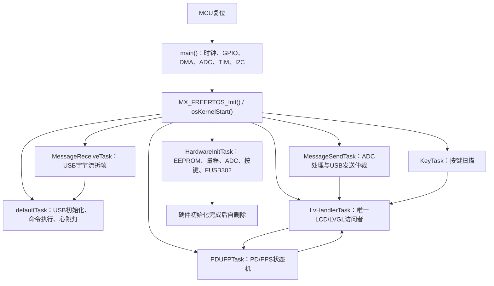
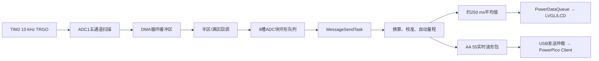

# PowerPico 复刻与工程化整理

基于 STM32F411CEU6、FreeRTOS、LVGL、USB CDC 和 FUSB302 的便携式电压/电流测量与 USB PD/PPS 控制项目。

本仓库是对 [No-Chicken/Power-Pico](https://github.com/No-Chicken/Power-Pico) 的学习复刻和工程化整理，不是从零原创的商业产品。硬件设计、官方界面、上位机协议和官方 BootLoader 方案归原作者所有；本仓库重点记录本人对 App 固件的分阶段复刻、问题定位、可靠性补强、代码清理和实机验证过程。

> 当前状态：App 侧 STEP1～STEP10 已完成，阶段1～阶段8代码整理已完成并通过用户实机回归。独立 BootLoader（原计划STEP11）暂缓。

## 1. 项目功能

- TIM2 以 10 kHz 触发 ADC1 五通道扫描，DMA循环采集电压、三档电流和1.5 V参考信号。
- LOW / MID / HIGH 三档电流量程，以及带连续确认、切档跳过和冷却时间的自动量程。
- LCD显示电压、电流、功率和运行时间，支持按键、亮度、声音、语言、旋转和量程设置。
- USB CDC命令收发、实时波形上传和PowerPico Client联调。
- LOW / MID / HIGH独立增益与零点校准，参数保存到BL24C02 EEPROM。
- FUSB302 USB PD协议通信，支持Fixed PDO与PPS APDO请求、停止和重新连接。
- App侧写入升级标志、释放USB并复位，对接官方BootLoader升级流程。

## 2. 项目来源与个人工作边界

### 上游项目提供的基础

- PowerPico硬件方案和产品功能定义。
- LCD界面风格、上位机通信格式及PowerPico Client。
- 官方PD/PPS业务思路和BootLoader升级方案。
- 上游项目地址：<https://github.com/No-Chicken/Power-Pico>
- 上游硬件地址：<https://oshwhub.com/no_chicken/powerpico>

### 本仓库完成的工作

- 从最小启动、USB CDC、EEPROM和LCD点屏开始，分阶段恢复完整App功能。
- 完成TIM2触发ADC、五通道DMA循环采样和任务上下文数据处理。
- 增加ADC块环形队列、序号断点检测、错误后旧数据清理和量程不匹配数据丢弃。
- 完成自动量程的升降档确认、MID贴近电源轨保护、切档后跳过和冷却。
- 完成USB命令拆帧、CRC校验、半包/粘包恢复，以及命令回复与波形数据统一发送仲裁。
- 完成三档校准参数的读取、写入、EEPROM回滚保护、恢复默认和自动零点链路。
- 针对PD/PPS链路补充会话复位、真实I2C错误上传、有界重试和Request发送失败重试。
- 修复PD失败页面生命周期问题，避免页面退出后定时器继续访问已删除对象。
- 清理历史实验代码和失效调试接口，简化ADC、USB消息调度和命令解析主链。
- 建立代码理解记录、验证记录和面试说明，明确已验证结果与未验证性能边界。

### 没有宣称完成的内容

- 没有把官方硬件、GUI、上位机和协议定义声明为本人原创。
- 没有独立实现官方BootLoader、YMODEM接收和Bootloader侧CRC32校验。
- 当前App只负责设置升级标志、退出USB并复位，然后由官方BootLoader接管。
- 没有完成A/B双分区、失败回滚和固件签名验证。

## 3. 硬件与软件栈

| 类别 | 当前工程 |
| --- | --- |
| MCU | STM32F411CEU6 |
| RTOS | FreeRTOS + CMSIS-RTOS2 |
| GUI | LVGL 9.5.0 + ST7789 LCD |
| 电流采样 | INA190A2，LOW/MID/HIGH三路采样链路 |
| 分流电阻 | 50 Ω / 0.5 Ω / 5 mΩ |
| PD控制器 | FUSB302 |
| 参数存储 | BL24C02 EEPROM |
| PC通信 | USB CDC虚拟串口 |
| 开发环境 | STM32CubeMX + Keil MDK-ARM |
| 已验证编译器 | Arm Compiler 5.06 update 7 (build 960) |

## 4. 软件架构



### 4.1 任务职责

| 任务 | 主要职责 | 关键约束 |
| --- | --- | --- |
| `defaultTask` | 初始化USB Device，执行已解析命令，翻转心跳灯 | 不直接刷新LCD |
| `HardwareInitTask` | 加载EEPROM、恢复量程、启动ADC、初始化按键和FUSB302 | 只运行一次，完成后删除自身 |
| `MessageSendTask` | 消费ADC数据块，发布LCD数据，仲裁命令回复和波形发送 | USB发送侧唯一管理者，命令优先 |
| `MessageReceiveTask` | 消费USB接收块，处理半包、粘包、噪声和CRC | 不在USB回调中做复杂解析 |
| `KeyTask` | 扫描五个物理按键并产生按键事件 | 不直接操作页面对象 |
| `PDUFPTask` | 执行START/STOP、轮询FUSB302、推进Fixed/PPS协商 | 优先级略高于LVGL任务 |
| `LvHandlerTask` | 初始化LVGL、处理按键和PD事件、刷新测量数据 | 唯一允许访问LCD和LVGL对象的任务 |

### 4.2 六条业务消息队列

| 队列 | 写入者 | 读取者 | 用途 |
| --- | --- | --- | --- |
| `Key_MessageQueue` | `KeyTask` | `LvHandlerTask` | 物理按键事件 |
| `PD_cmd_MessageQueue` | LVGL页面 | `PDUFPTask` | PD/PPS启动、停止和参数命令 |
| `PD_handle_event_MsgQueue` | `PDUFPTask` | `LvHandlerTask` | 协商成功、失败和停止事件 |
| `PowerDataQueue` | `MessageSendTask` | `LvHandlerTask` | 约250 ms平均测量值 |
| `CmdRxQueue` | USB CDC接收回调 | `MessageReceiveTask` | USB原始接收字节块 |
| `CmdTxQueue` | 命令策略模块 | `MessageSendTask` | 等待发送的完整命令回复帧 |

## 5. 核心数据流

### 5.1 ADC到LCD与上位机



ADC中断只复制固定大小数据、发布队列并通知任务，不在中断里做浮点换算、自动量程或USB发送。

### 5.2 USB命令链路

```text
USB CDC接收回调
  -> CmdRxQueue
  -> MessageReceiveTask追加字节流并提取完整帧
  -> CRC与命令参数检查
  -> defaultTask执行命令
  -> CmdTxQueue
  -> MessageSendTask优先发送命令回复
  -> USB发送完成回调释放active_tx
```

发送侧保留三类缓冲状态：`pending_command`、`pending_adc`和`active_tx`。命令回复优先；尚未发送的旧波形允许被最新波形覆盖；正在USB底层使用的`active_tx`只有收到发送完成通知后才能复用。

### 5.3 PD/PPS链路

```text
LVGL Fixed/PPS页面
  -> PD_cmd_MessageQueue
  -> PDUFPTask复位本轮会话并接通CC_EN
  -> FUSB302检测CC方向和Source Capabilities
  -> PD协议层选择Fixed PDO或PPS APDO
  -> Request成功写入FUSB302后等待PS_RDY
  -> PD_handle_event_MsgQueue
  -> LvHandlerTask更新页面
```

系统冷启动只初始化FUSB302并保持`CC_EN`断开，不会自动发起PD协商。

## 6. 目录结构

```text
PowerPico/
├─ DOC/                         项目进度、整理计划和个人代码理解记录
├─ STM32F411CEU6/software/App/my_power_pico/
│  ├─ Core/                     CubeMX生成的启动和外设初始化代码
│  ├─ BSP/                      EEPROM、量程开关、LCD、PD等板级驱动
│  ├─ User/                     ADC、命令策略、GUI和业务任务
│  ├─ USB_DEVICE/               STM32 USB Device/CDC接口
│  ├─ Middlewares/              FreeRTOS、LVGL和USB中间件
│  ├─ Drivers/                  STM32 HAL/CMSIS
│  ├─ MDK-ARM/my_power_pico.uvprojx
│  └─ my_power_pico.ioc
├─ .gitignore
└─ README.md
```

重点阅读顺序：

1. `Core/Src/main.c`
2. `Core/Src/freertos.c`
3. `User/Tasks/Src/user_TasksInit.c`
4. `User/Tasks/Src/user_HardwareInitTask.c`
5. `User/user_AdcDataStrategy.c`
6. `User/Tasks/Src/user_MessageTask.c`
7. `User/user_CmdStrategy.c`
8. `User/Tasks/Src/user_PDUFPTask.c`

## 7. 编译方法

### 7.1 已验证环境

- Windows 11
- Keil uVision 5.35
- Arm Compiler 5.06 update 7 (build 960)
- ARM CMSIS 5.8.0 Pack
- Keil STM32F4xx DFP 2.17.0 Pack

这些是当前实际通过构建的版本，不代表唯一可用版本。

### 7.2 Keil构建

1. 克隆仓库。
   建议使用较短的本地路径，例如`G:\PowerPico`。Arm Compiler 5和部分旧版Windows工具仍可能受路径长度限制，目录过深时会出现LVGL深层头文件找不到的问题。
2. 打开：

   ```text
   STM32F411CEU6/software/App/my_power_pico/MDK-ARM/my_power_pico.uvprojx
   ```

3. 选择Target：`my_power_pico`。
4. 执行Build。
5. 生成的AXF、HEX、BIN、MAP和中间文件位于：

   ```text
   STM32F411CEU6/software/App/my_power_pico/MDK-ARM/my_power_pico/
   ```

这些构建产物已由`.gitignore`排除，不应提交到仓库。

命令行构建示例：

```powershell
& 'D:\keil\UV4\UV4.exe' -b `
  '.\STM32F411CEU6\software\App\my_power_pico\MDK-ARM\my_power_pico.uvprojx' `
  -t 'my_power_pico'
```

当前阶段8增量构建结果：

```text
0 Error(s), 0 Warning(s)
Code=184180  RO-data=155232  RW-data=1468  ZI-data=91492
Total ROM=339792 bytes  Total RW=92960 bytes
```

工程文件变化触发的全量重编译为`0 Error、138 Warning`。告警来自现有LVGL和多语言源文件，当前业务修改文件没有新增告警；因此“全量干净构建0 Warning”仍是后续工程化待办，不能只用增量构建结果掩盖。

## 8. 烧录与官方BootLoader边界

本App链接在`0x08010000`，中断向量表也重定位到`0x08010000`。链接空间为`0x00070000`，即448 KiB。

### 已有官方BootLoader的开发板

推荐使用PowerPico Client和官方YMODEM升级流程烧录构建生成的`my_power_pico.bin`。App能够写入EEPROM升级标志、断开USB并复位，随后由官方BootLoader接管。

### 使用SWD调试App

Keil工程和scatter文件已经把App放在`0x08010000`。下载前必须确认擦除策略不会执行全片擦除，否则可能清除`0x08000000`处的官方BootLoader。

### 重要说明

- 本仓库没有包含本人独立实现的BootLoader工程。
- 官方BootLoader、YMODEM接收、镜像校验和跳转逻辑不属于本仓库App侧成果。
- 不要为了方便下载把App链接地址改为`0x08000000`，否则会覆盖BootLoader。
- BootLoader获取和首次烧录请参考上游Power-Pico项目说明。

## 9. 已验证结果

以下实机结果均为仓库维护者在PowerPico开发板上的用户确认结果，不表述为自动化测试或实验室计量认证。

| 验证项 | 测试条件 | 结果 |
| --- | --- | --- |
| 冷启动 | 连续冷启动20次 | 20次均正常进入界面和测量状态 |
| ADC/LCD/按键 | 空载及ESP32动态负载 | 采样、显示和按键操作正常 |
| 自动量程 | ESP32接入后升档，断载后降档 | 能升到合适档位并在断载后回到零点附近 |
| USB枚举与重连 | Windows + PowerPico Client | 枚举、断开和重新连接正常 |
| USB实时波形 | ESP32约5 V动态负载 | 连续上传正常，LCD和客户端结果基本对应 |
| USB连续命令 | 连续读取校准参数20次 | 20次均成功 |
| EEPROM参数加载 | 重新启动后读取三档校准参数 | LOW/MID/HIGH参数正常加载 |
| PD默认状态 | 冷启动后未主动进入PD页面 | 默认不接通CC，不自动协商 |
| Fixed PDO | 主动启动、停止和重新连接 | 正常 |
| PPS APDO | 主动启动、停止和重新连接 | 正常 |
| App进入BootLoader | 写入升级标志、释放USB并复位 | 能进入官方BootLoader升级路径 |

现有条件下，空载平均电流能够回到0 uA附近；ESP32负载下曾观察到约4.97 V、约182 mA的平均值和周期性电流脉冲。该结果用于证明链路响应和显示一致性，不用于声明绝对测量精度。

## 10. 当前未完成的性能验证

受当前没有可调电子负载、标准负载电阻和可追溯高精度电流参考仪表限制，下面项目尚未形成可靠结论：

- LOW/MID/HIGH三档绝对精度和增益误差。
- 全量程线性、重复性和量程切换边界误差。
- 温漂、长期零点漂移和不同供电条件下的稳定性。
- 满载能力、分流电阻温升和PCB热分布。
- USB/PD长时间压力、EMC/ESD和异常电源场景。
- 命令协议的系统化模糊测试；半包、粘包、噪声和CRC恢复目前主要依靠源码路径检查与已有功能回归。
- 全量重编译中的第三方源码告警清零。

因此，本项目当前适合作为功能复刻、嵌入式软件架构和问题定位能力展示，不应描述为已经完成计量认证的仪表产品。

## 11. 工程化亮点

- 中断与任务边界明确：ADC/USB回调只搬运数据和发通知，复杂逻辑放到任务上下文。
- 数据所有权明确：ADC块环形队列、USB三类发送缓冲和LVGL单任务访问避免并发覆盖。
- 自动量程不只看单点阈值，还包含连续确认、换挡跳过、冷却和MID电源轨保护。
- EEPROM保存失败会恢复旧RAM参数，避免“RAM已经变、Flash没保存”的半成功状态。
- PD会话START/STOP统一复位缓存、消息ID、CC方向和FUSB302连接状态。
- 对官方代码保持可追溯差异，关键PD修复可搜索`STEP9修复说明`定位。
- 文档明确区分“编译通过、用户实机确认、推测”和“尚未验证”。

## 12. 项目文档

- [项目整理和打磨](DOC/项目整理和打磨.txt)
- [项目复刻进度记录](DOC/项目复刻进度记录.txt)
- [项目复刻过程笔记](DOC/项目复刻过程笔记.txt)
- [个人代码理解记录](DOC/个人代码理解记录.docx)：面试前代码主链和核心函数理解记录。

## 13. 后续计划

- 补充项目演示视频、PD/PPS协商过程和关键逻辑分析仪截图。
- 使用可调电子负载与参考仪表完成三档精度、线性、温漂和满载验证。
- 评估第三方告警处理方式，建立全量构建质量基线。
- 完成最终发布检查后再创建版本标签，例如`v0.1.0-app-release`。
- 独立BootLoader开发继续暂缓，不与当前已验证App版本混在同一阶段。

## 14. 许可与致谢

感谢[油炸鸡开源硬件（No-Chicken）](https://github.com/No-Chicken)公开Power-Pico项目。本仓库当前没有新增单独的顶层许可证文件；复制、修改或发布上游来源内容前，请同时核对并遵守上游仓库及各第三方组件的许可证要求。
