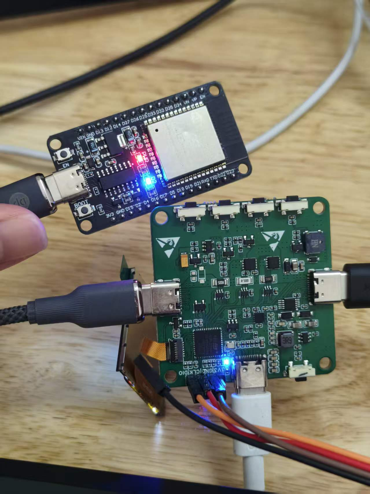
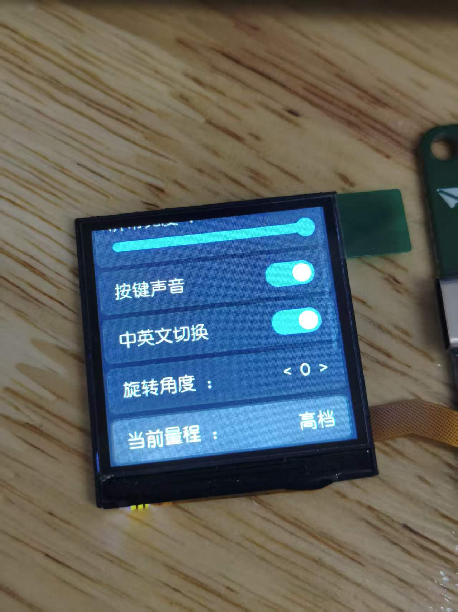
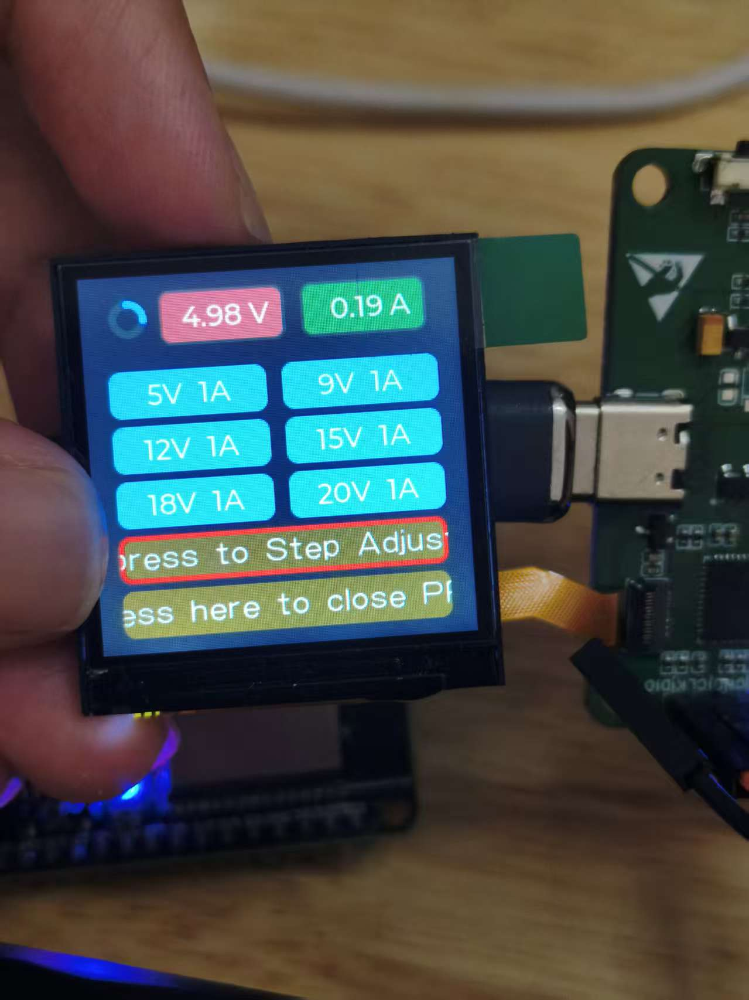
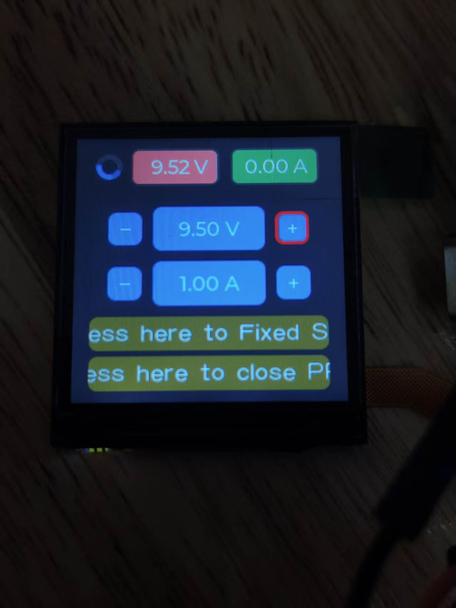
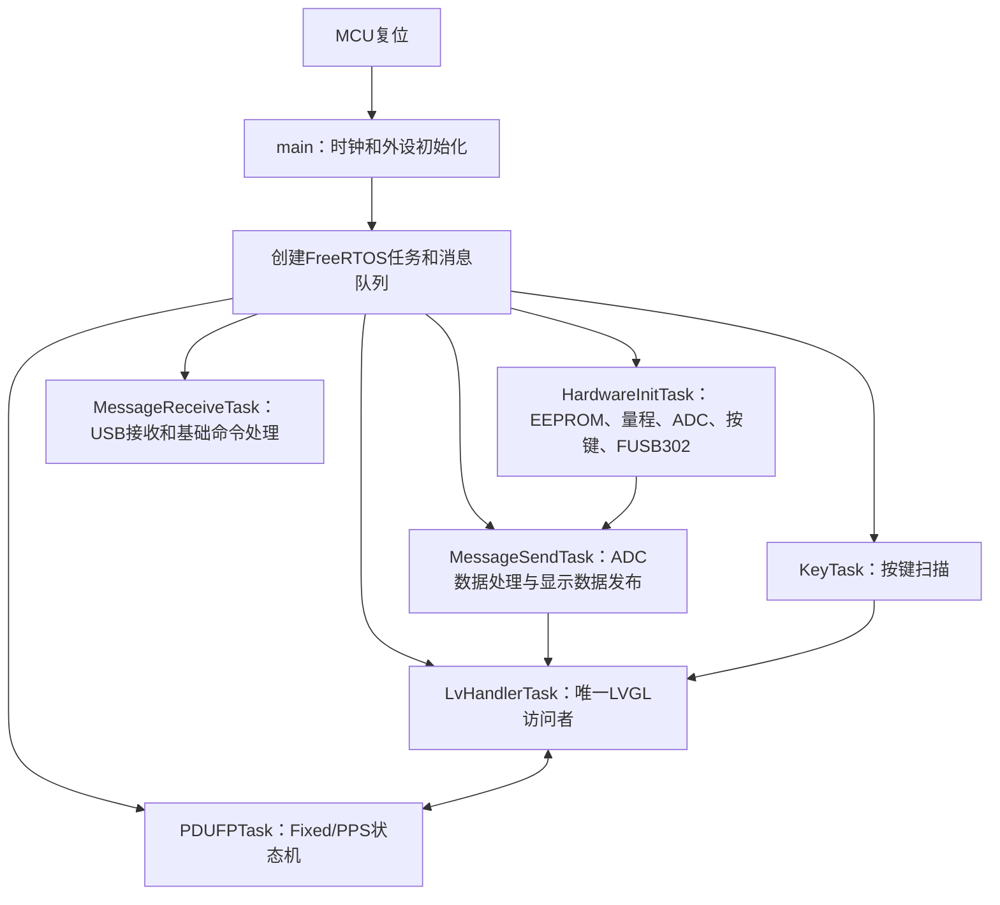

# PowerPico 复刻与工程化整理

基于 STM32F411CEU6、FreeRTOS、LVGL、USB CDC 和 FUSB302 的便携式电压/电流测量与 USB PD/PPS 控制项目。

本仓库是对 [No-Chicken/Power-Pico](https://github.com/No-Chicken/Power-Pico) 的学习复刻和工程化整理，不是从零原创的商业产品。硬件方案、官方界面、上位机程序、通信格式和官方 BootLoader 方案归原作者所有；本仓库重点展示本人对 App 固件的分阶段复刻、问题定位、可靠性补强、代码清理和实机验证过程。

## 1. 项目展示

| ESP32 动态负载测试 | 设备设置页面 |
| --- | --- |
|  |  |

| Fixed PDO 控制页面 | PPS 步进调压页面 |
| --- | --- |
|  |  |

完整的功能回归、稳态电压对比和动态调压波形见 [实机测试报告](TEST_REPORT.md)。

## 2. 项目功能

- TIM2 以 10 kHz 触发 ADC1 五通道扫描，DMA 循环采集电压、三档电流和 1.5 V 参考信号。
- LOW / MID / HIGH 三档电流量程，以及带连续确认、切档跳过和冷却时间的自动量程。
- LCD 显示电压、电流、功率和运行时间，支持按键、亮度、声音、语言、旋转和量程设置。
- LOW / MID / HIGH 独立增益与零点校准，参数保存到 BL24C02 EEPROM。
- FUSB302 USB PD 通信，支持 Fixed PDO 与 PPS APDO 请求、停止和重新连接。
- USB CDC 按上游既有格式完成基础命令交互和实时波形联调。
- App 侧写入升级标志、释放 USB 并复位，对接官方 BootLoader 升级流程。

## 3. 项目来源与个人工作边界

### 上游项目提供的基础

- PowerPico 硬件方案、产品功能定义和 LCD 界面设计。
- 上位机程序、通信格式、PD/PPS 业务思路和 BootLoader 升级方案。
- 上游项目地址：<https://github.com/No-Chicken/Power-Pico>
- 上游硬件地址：<https://oshwhub.com/no_chicken/powerpico>

### 本仓库完成的工作

- 从最小启动、USB CDC、EEPROM 和 LCD 点屏开始，分阶段恢复完整 App 功能。
- 完成 TIM2 触发 ADC、五通道 DMA 循环采样和任务上下文数据处理。
- 增加 ADC 块环形队列、序号断点检测、错误恢复和量程不匹配数据丢弃。
- 完成自动量程的升降档确认、MID 贴近电源轨保护、切档跳过和冷却。
- 完成三档校准参数读取、写入、保存失败回滚、恢复默认和自动零点链路。
- 针对 PD/PPS 链路补充会话复位、真实 I2C 错误上传、有界重试和发送失败重试。
- 修复 PD 失败页面生命周期问题，避免页面退出后定时器继续访问已删除对象。
- 清理历史实验代码和失效调试接口，简化 ADC、消息调度和命令处理主链。
- 按既有 USB 通信格式完成 App 侧基础收发，并使用官方 PowerPico Client 做实机联调。

> 项目边界：上位机源码未公开，本仓库不包含上位机实现；USB 部分只记录 App 侧基础收发和实机联调。BootLoader 继续沿用官方版本。

## 4. 硬件与软件栈

| 类别 | 当前工程 |
| --- | --- |
| MCU | STM32F411CEU6 |
| RTOS | FreeRTOS + CMSIS-RTOS2 |
| GUI | LVGL 9.5.0 + ST7789 LCD |
| 电流采样 | INA190A2，LOW / MID / HIGH 三路采样链路 |
| 分流电阻 | 50 Ω / 0.5 Ω / 5 mΩ |
| PD 控制器 | FUSB302 |
| 参数存储 | BL24C02 EEPROM |
| PC 通信 | USB CDC 虚拟串口 |
| 开发环境 | STM32CubeMX + Keil MDK-ARM |
| 已验证编译器 | Arm Compiler 5.06 update 7 (build 960) |

## 5. 软件架构



### ADC 与自动量程主链

```text
TIM2 10 kHz触发
  -> ADC1五通道扫描
  -> DMA半区/满区回调复制数据块
  -> ADC块环形队列
  -> MessageSendTask换算、校准和自动量程判断
  -> 约250 ms平均值发送给LVGL任务
```

ADC 中断只搬运固定大小的数据并通知任务，浮点换算、自动量程和业务处理放在任务上下文完成。

### PD/PPS 主链

```text
LVGL Fixed/PPS页面
  -> PD命令队列
  -> PDUFPTask复位会话并接通CC_EN
  -> FUSB302接收Source Capabilities
  -> 选择Fixed PDO或PPS APDO并发送Request
  -> 收到协商结果后通过事件队列更新页面
```

系统冷启动只初始化 FUSB302 并保持 `CC_EN` 断开，不会自动发起 PD 协商。

### USB 联调边界

App 侧通过 USB CDC 接收上位机字节流，在任务中完成基础帧处理，再发送命令回复或波形数据。公开材料只记录已经完成的枚举、重连、命令和波形联调结果，不展开上位机内部实现，也不把上游通信格式算作个人原创成果。

## 6. 目录结构

```text
PowerPico/
├─ assets/images/               README和测试报告使用的实机图片
├─ TEST_REPORT.md               功能回归与测量结果
├─ DEBUG_NOTES.md               典型问题定位和阶段性调试记录
├─ STM32F411CEU6/software/App/my_power_pico/
│  ├─ Core/                     CubeMX生成的启动和外设初始化代码
│  ├─ BSP/                      EEPROM、量程开关、LCD、PD等板级驱动
│  ├─ User/                     ADC、命令策略、GUI和业务任务
│  ├─ USB_DEVICE/               STM32 USB Device/CDC接口
│  ├─ Middlewares/              FreeRTOS、LVGL和USB中间件
│  ├─ Drivers/                  STM32 HAL/CMSIS
│  ├─ MDK-ARM/my_power_pico.uvprojx
│  └─ my_power_pico.ioc
├─ .gitignore
└─ README.md
```

推荐代码阅读顺序：

1. `Core/Src/main.c`
2. `Core/Src/freertos.c`
3. `User/Tasks/Src/user_TasksInit.c`
4. `User/Tasks/Src/user_HardwareInitTask.c`
5. `User/user_AdcDataStrategy.c`
6. `User/Tasks/Src/user_MessageTask.c`
7. `User/user_CmdStrategy.c`
8. `User/Tasks/Src/user_PDUFPTask.c`

## 7. 编译方法

已验证环境：Windows 11、Keil uVision 5.35、Arm Compiler 5.06 update 7 (build 960)、ARM CMSIS 5.8.0 Pack、Keil STM32F4xx DFP 2.17.0 Pack。

1. 建议克隆到较短路径，例如 `G:\PowerPico`，避免旧版工具受到 Windows 路径长度影响。
2. 打开 `STM32F411CEU6/software/App/my_power_pico/MDK-ARM/my_power_pico.uvprojx`。
3. 选择 Target `my_power_pico`，执行 Build。

阶段8增量构建结果：

```text
0 Error(s), 0 Warning(s)
Code=184180  RO-data=155232  RW-data=1468  ZI-data=91492
Total ROM=339792 bytes  Total RW=92960 bytes
```

工程文件变化触发的全量重编译为 `0 Error、138 Warning`。告警来自现有 LVGL 和多语言源文件，当前业务修改文件没有新增告警。因此不能把增量构建结果表述成“全工程零告警”。

## 8. 烧录与 BootLoader 边界

本 App 链接在 `0x08010000`，中断向量表也重定位到 `0x08010000`，链接空间为 448 KiB。

### 沿用原作者开发的上位机更新固件版本

推荐使用 PowerPico Client 和官方 YMODEM 升级流程烧录生成的 `my_power_pico.bin`。App 写入 EEPROM 升级标志、断开 USB 并复位后，由官方 BootLoader 接管。

### 使用 SWD 调试 App

Keil 工程和 scatter 文件已经把 App 放在 `0x08010000`。下载前必须确认擦除策略不会执行全片擦除，否则可能清除 `0x08000000` 处的官方 BootLoader。

BootLoader 程序仍沿用官方版本。

## 9. 已验证结果

以下结果均为仓库维护者在实机上的用户确认，不表述为自动化测试或实验室计量认证。

| 验证项 | 结果 |
| --- | --- |
| 连续冷启动20次 | 均正常进入界面和测量状态 |
| ADC、LCD、按键 | 空载和ESP32动态负载下均正常 |
| 自动量程 | 接入负载后升档，断开负载后降档并回到零点附近 |
| EEPROM参数 | 三档校准参数可加载，连续读取20次正常 |
| USB基础联调 | 枚举、重连、命令交互和实时波形显示正常 |
| PD默认状态 | 冷启动后不主动接通CC，不自动协商 |
| Fixed/PPS | 主动启动、停止和重新连接正常 |
| App进入BootLoader | 能写升级标志、释放USB并进入BootLoader升级路径 |

稳态电压对比中，PowerPico 显示值与 VC9205C 现场参考值的最大相对差值为 0.40%。该结果只能说明本次测试条件下两者读数接近，不能替代标准源、校准仪表或 USB PD 一致性认证。详细数据见 [TEST_REPORT.md](TEST_REPORT.md)。

## 10. 工程化处理要点

- ADC 和 USB 回调只搬运数据、发通知，复杂处理放到任务上下文。
- ADC 块队列保留序号断点检测、错误恢复和切档期间旧数据丢弃。
- 自动量程包含连续确认、切档跳过、冷却和 MID 电源轨保护，避免频繁抖档。
- EEPROM 保存失败会恢复旧 RAM 参数，避免出现只改内存、没有真正保存的半成功状态。
- PD START/STOP 会统一复位会话缓存、消息 ID、CC 方向和连接状态。
- LVGL 对象只由界面任务访问，页面退出时同步停止页面私有定时器。
- 文档明确区分编译结果、用户实机确认、推测和尚未验证内容。

## 11. 尚未完成的验证

- 三档电流量程的绝对精度、线性、重复性和温漂。
- 满载能力、分流电阻温升和 PCB 热分布。
- 长时间 USB/PD 压力、EMC/ESD 和异常电源测试。
- 使用专业协议分析仪完成 USB PD 一致性验证。
- 全量重编译中的第三方源码告警清零。

因此，本项目适合作为功能复刻、嵌入式软件架构、调试过程和工程化整理能力展示，不应描述为已经完成计量认证的仪表产品。

## 12. 公开文档

- [实机测试报告](TEST_REPORT.md)：功能回归、稳态电压对比和 PD/PPS 动态波形。
- [调试与问题记录](DEBUG_NOTES.md)：典型问题、阶段性验证页面和处理结论。

## 13. 许可与致谢

感谢 [油炸鸡开源硬件（No-Chicken）](https://github.com/No-Chicken) 公开 Power-Pico 项目。本仓库当前没有新增单独的顶层许可证文件；复制、修改或发布上游来源内容前，请同时核对并遵守上游仓库及各第三方组件的许可证要求。
