# PowerPico 实机测试报告

## 1. 报告范围

本报告记录当前 App 固件的功能回归、稳态输出电压对比和 PD/PPS 动态过程观察。

- 功能结果来自当前 PowerPico 开发板实机测试。
- 稳态电压以 VC9205C 万用表作为现场参考，不属于实验室计量校准。
- DSO-510 只用于观察电压切换趋势，不用于替代万用表给出稳态精度结论。
- 官方 PowerPico Client 只用于基础通信联调；其源码未公开，本报告不分析上位机内部实现。

## 2. 测试设备

| 设备 | 用途 | 使用边界 |
| --- | --- | --- |
| PowerPico 开发板 | 被测设备，显示板载ADC测量结果 | 当前项目样机 |
| VICTOR VC9205C | 测量稳态直流输出电压 | 3½位、1999计数，作为现场参考，不是可追溯标准表 |
| FNIRSI DSO-510 | 观察Fixed切换和PPS步进趋势 | 单通道，DC耦合，X1探头，AUTO连续采集 |
| ESP32开发板及LCD | 动态负载 | 用于观察电流波形和自动量程响应 |
| 官方PowerPico Client | USB枚举、基础命令和波形联调 | 不包含上位机源码，不扩展其功能说明 |

## 3. 功能回归

| 验证项 | 测试条件 | 结果 |
| --- | --- | --- |
| 冷启动 | 连续断电重启20次 | 20次均正常进入界面和测量状态 |
| ADC/LCD/按键 | 空载及ESP32动态负载 | 采样、显示和按键操作正常 |
| 自动量程 | ESP32接入后升档，断载后降档 | 能切换到合适档位，断载后回到零点附近 |
| USB基础联调 | Windows + 官方PowerPico Client | 枚举、断开重连、命令和实时波形正常 |
| 连续读取参数 | 连续读取校准参数20次 | 20次均成功 |
| EEPROM参数加载 | 重启后读取LOW/MID/HIGH参数 | 三档参数正常加载 |
| PD默认状态 | 冷启动后不主动进入PD页面 | 不接通CC，不自动协商 |
| Fixed PDO | 主动启动、停止和重新连接 | 正常 |
| PPS APDO | 主动启动、停止和重新连接 | 正常 |
| App进入BootLoader | 写入升级标志、释放USB并复位 | 能进入官方BootLoader升级路径 |

## 4. 稳态输出电压对比

计算口径：

```text
差值 = PowerPico显示值 - VC9205C实测值
相对差值 = |差值| / VC9205C实测值 × 100%
```

| 模式 | 目标电压 | PowerPico显示值 | VC9205C实测值 | 差值 | 相对差值 |
| --- | ---: | ---: | ---: | ---: | ---: |
| 默认 | 5.00 V | 4.98 V | 4.96 V | +0.02 V | 0.40% |
| Fixed | 9.00 V | 8.97 V | 8.94 V | +0.03 V | 0.34% |
| Fixed | 12.00 V | 11.95 V | 11.93 V | +0.02 V | 0.17% |
| Fixed | 15.00 V | 14.95 V | 14.92 V | +0.03 V | 0.20% |
| Fixed | 20.00 V | 19.94 V | 19.87 V | +0.07 V | 0.35% |
| PPS | 5.00 V | 4.98 V | 4.96 V | +0.02 V | 0.40% |
| PPS | 7.00 V | 6.97 V | 6.95 V | +0.02 V | 0.29% |
| PPS | 9.60 V | 9.52 V | 9.54 V | -0.02 V | 0.21% |

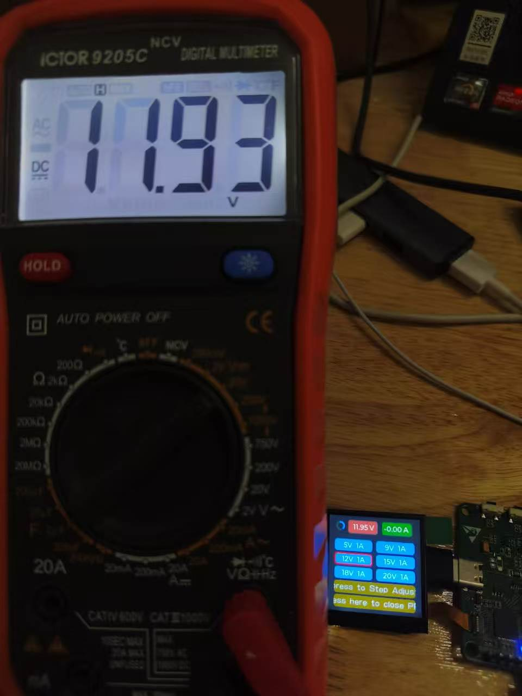

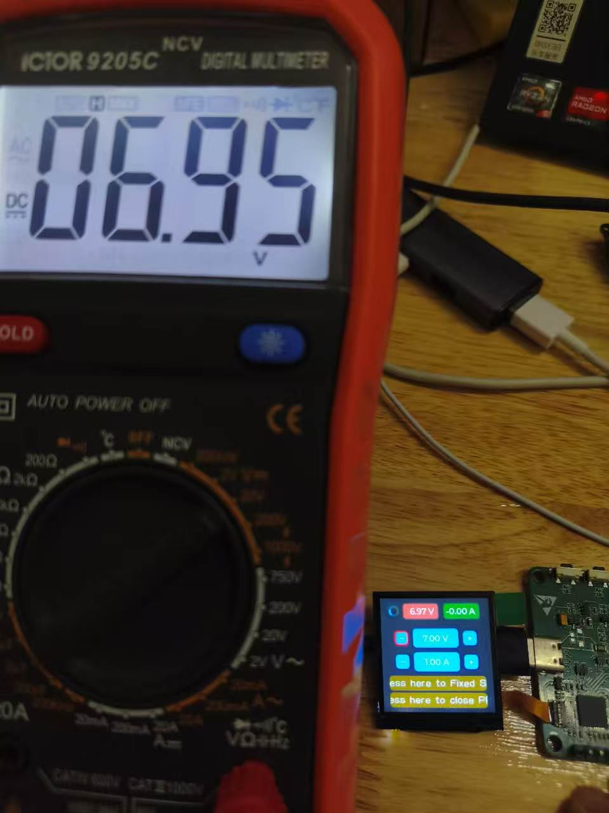

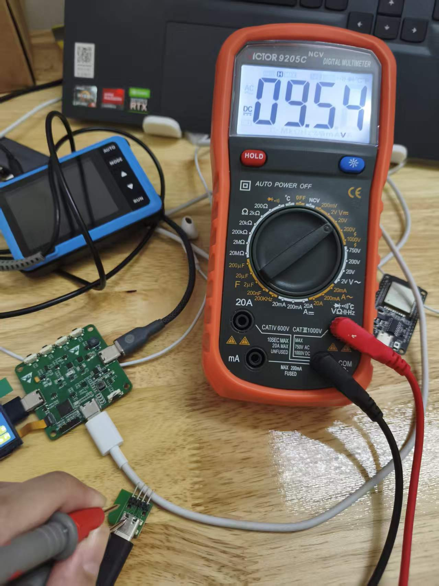

结论：这组数据中最大相对差值为 0.40%。这只能说明当前样机与 VC9205C 在本次无载或轻载条件下读数接近，不能据此宣称绝对精度、全量程线性或 PD 协议认证通过。

## 5. 零点校准与动态负载

| 自动零点校准前 | 自动零点校准后 |
| --- | --- |
| 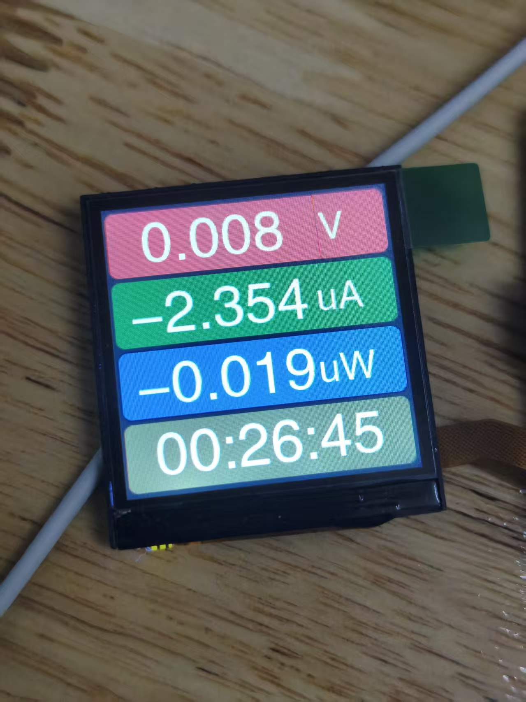 | 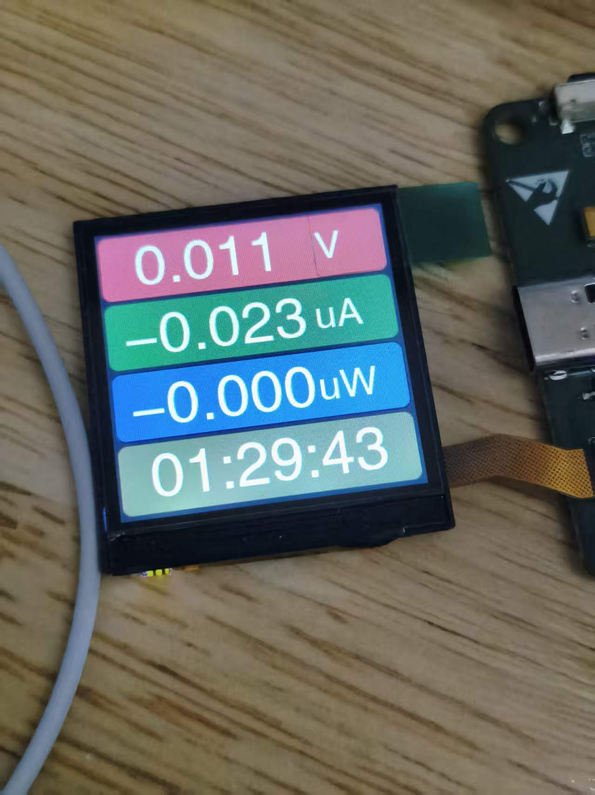 |

自动零点校准后，空载电流能够回到 0 uA 附近。接入 ESP32 动态负载后，LCD 和上位机显示的平均电压、电流趋势基本对应，AUTO 模式能够逐步升档；断开负载后能够逐步降档并回到零点附近。

三档校准参数能够从设备读取，连续读取 20 次均正常：

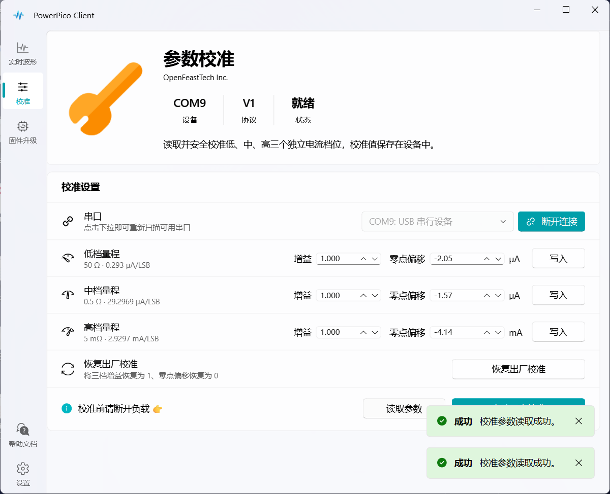

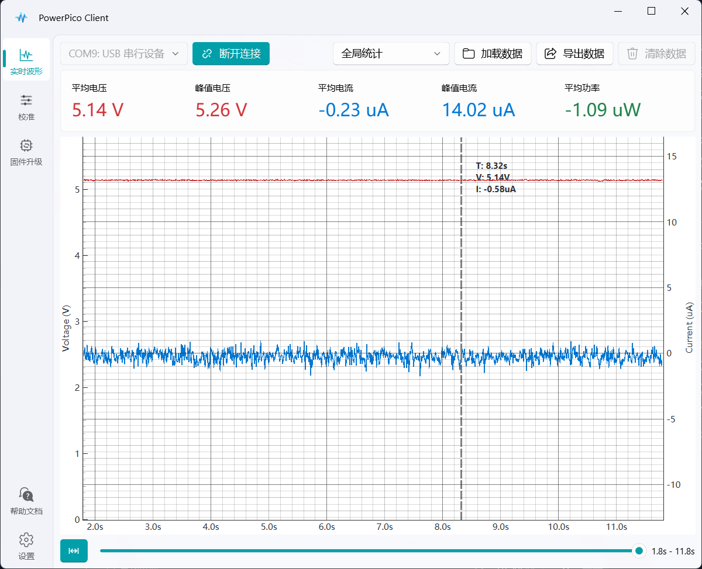

上图只用于证明 USB CDC 波形数据能够连续到达官方客户端并正常显示，不用于说明上位机内部实现或完整协议设计能力。

## 6. PD/PPS 动态过程观察

示波器设置：DC 耦合、X1 探头、2 V/div、AUTO 连续采集。Fixed 切换使用约 500 ms/div，PPS 连续步进使用约 1 s/div。

由于 DSO-510 的单次触发在本次接法下不容易稳定抓取，本次统一使用 AUTO 连续采集。因此图片边缘可能保留前一次扫描的旧波形：PPS 升压图最右侧的突然下降、PPS 降压图最左侧的突然上升属于旧采集残留，不代表 VBUS 实际发生异常跳变。

### Fixed 5 V 与 9 V 切换

| 5 V → 9 V | 9 V → 5 V |
| --- | --- |
| 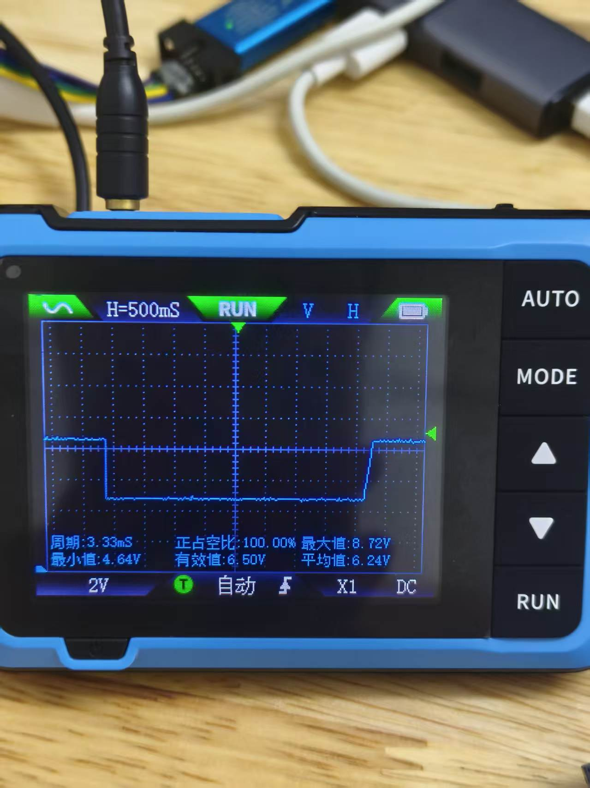 | 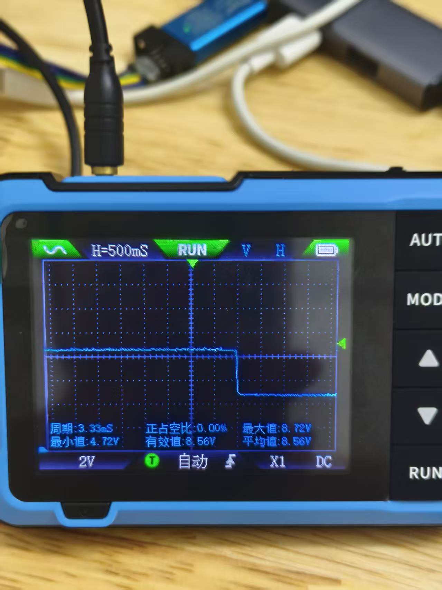 |

波形能够观察到 Fixed 档位切换后的电压平台变化。本次只做定性展示，不从 AUTO 波形中计算精确过冲和稳定时间。

### PPS 连续步进

| 连续升压 | 连续降压 |
| --- | --- |
| 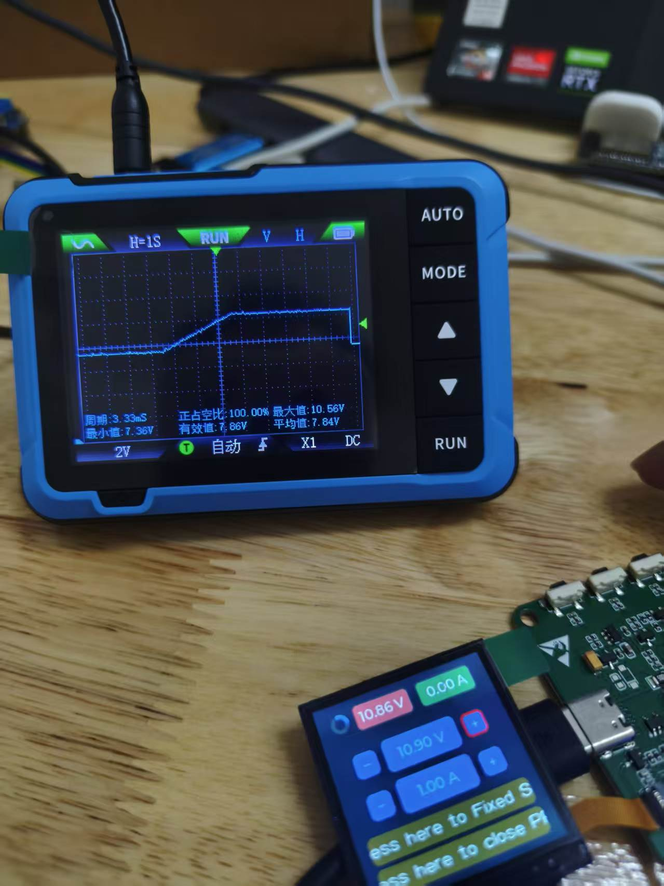 | 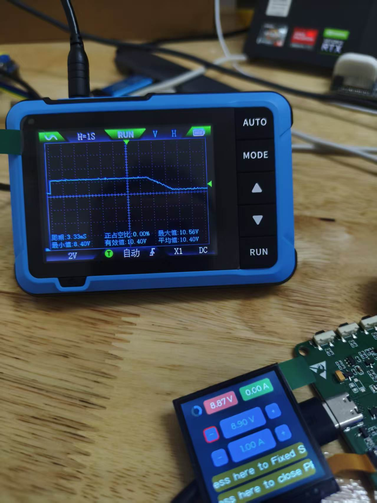 |

波形能够观察到 PPS 目标电压连续增加和连续降低的整体趋势。受采样方式、示波器直流读数偏差和旧波形残留影响，本次不把示波器平均值纳入稳态精度表。

## 7. 当前结论与限制

- 功能回归覆盖了冷启动、ADC/LCD/按键、自动量程、EEPROM、USB基础联调和PD/PPS启停。
- 稳态输出电压使用万用表记录，PowerPico 与现场参考值最大相对差值为 0.40%。
- 示波器验证了 Fixed 切换和 PPS 连续调压趋势，但没有形成精确的上升时间、过冲和纹波结论。
- 尚缺少可调电子负载、标准电压/电流源、可追溯参考表和PD协议分析仪，因此不能给出计量等级或协议一致性结论。
